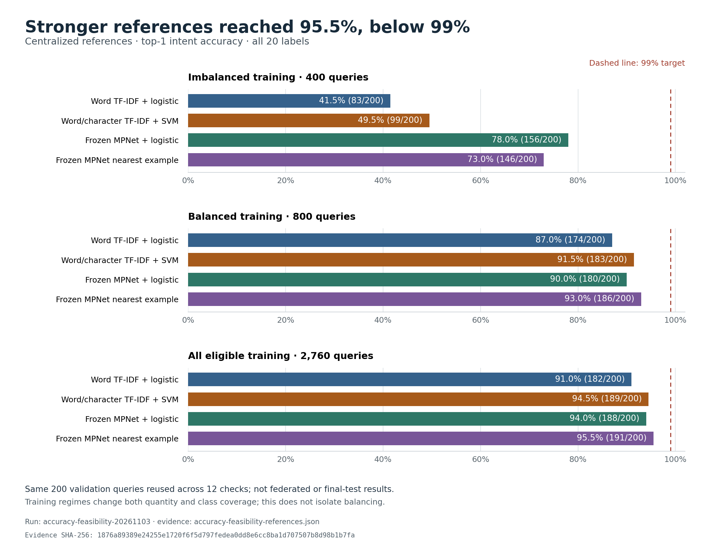

# Can FedLoRA-Edge reach 99% accuracy?

Review date: **3 November 2026**. We ran twelve stronger task-reference checks;
the best achieved **95.5% validation accuracy, 191/200**, using frozen MPNet
embeddings and 2,760 eligible training examples. None reached 99% top-1 accuracy.
A subsequent diagnostic found **99% top-2 candidate recall**; this means the
correct label appears among two suggestions, not that the model selects it.
Reviewing its
nine errors also exposed ambiguous requests and suspected annotation
inconsistencies. For the chosen small-model/frozen-A recipe with only two or
three minority examples per intent, **99% is not an evidence-supported promise**.
It remains possible in principle on a finite sample, but these experiments do
not establish an intrinsic ceiling or show that a future model will reach it.

## Define the target before optimizing

| Claim | What it actually requires |
| --- | --- |
| 99% on the fixed final test | At least 495 correct out of 500 queries, with all twenty labels available |
| 99% on validation | At least 198 correct out of 200; useful for development, not independent final confirmation |
| 99% among automatically answered queries | A selective-prediction metric; also report how many queries were answered and deferred |
| 99% on future users | Evidence from representative future data; a finite benchmark score alone does not establish it |
| 99% training accuracy | Fit to known examples; not a measurement of unseen-query performance |

An observed 495/500 has a nominal 95% Wilson interval of about **97.68–99.57%**.
For 198/200 the corresponding interval is **96.43–99.73%**. These intervals assume
independent representative examples; they do not account for repeated model
selection on validation, fixed class stratification, or domain shift. In
particular, observing 99% is not the same as establishing a population accuracy
of at least 99%.

Our test is balanced at 100 queries per domain. With at most five errors in
total, even the weakest domain would need at least 95/100 correct. The main
system currently gets 14/100 correct in its weakest domain. Closing that gap
requires substantially better generalization, not just rounding an aggregate
percentage or changing the weighting display.

This is also a closed-set benchmark: every evaluated query belongs to one of
the twenty supported intents. Even a 99% score here would not establish 99%
accuracy on arbitrary banking questions, unsupported intents or unrelated text.
The current query interface always chooses a supported label; out-of-scope
detection and clarification need their own evaluation.

## What our evidence says now

| Experiment | Split | Accuracy | Scope |
| --- | --- | ---: | --- |
| Frozen SmolLM2, original score | Final test, 500 | 32.0% | Same task and original scoring rule |
| Sample-weighted B-only training, attempt 20 | Final test, 500 | 24.6% | Imbalanced heterogeneous seed-42 run |
| Plain equal-weight B-only training, attempt 20 | Final test, 500 | 35.4% | Separates weighting from clipping |
| Equal weights plus clipping, attempt 20 | Final test, 500 | 34.4% | Same manifests, 640 accepted optimizer steps and 2,560 presentations |
| Equal weights plus clipping, scripted dropout, attempt 20 | Final test, 500 | 33.4% | Client 1 killed on attempts 4/8/12; all 20 attempts committed |
| Centralized B-only reference, block 20 | Final test, 500 | 40.6% | Same declared data/work replay, different optimization path |
| Sample-weighted model, version 9, original score | Validation, 200 | 34.5% | Partial checkpoint; separate diagnostic |
| Same version 9, content-free-centered score | Validation, 200 | 64.5% | Same B; correction fixes 65 errors and harms five |
| Fixed TF-IDF classifier, imbalanced data | Validation, 200 | 41.5% | Centralized public-data reference, 400 training queries |
| Fixed TF-IDF classifier, balanced data | Validation, 200 | 87.0% | Centralized reference, 800 training queries |

The main method beats the sample-weighted baseline by 9.8 test percentage points,
but only exceeds the frozen model by 2.4 points. Worst-domain test accuracy is
14% for the main method, 2% for sample weighting, and 11% for the frozen base.
The completed plain-equal control scores 35.4%, one point above clipping, with
the same 14% worst-domain score. This supports reduced collapse relative to
sample weighting in this seed, but does not show a quality benefit from adding
clipping. The centralized reference's 40.6% is also far below 99%, so aggregation
is not the only limitation of this task/training configuration.

Sources: [base](results/pilot-base-complete.json),
[sample](results/pilot-sample-complete.json),
[main](results/pilot-main-complete.json),
[equal](results/pilot-equal-complete.json),
[centralized](results/pilot-centralized-complete.json),
[dropout](results/pilot-dropout-complete.json),
[scoring diagnosis](accuracy-diagnosis.md), and its linked TF-IDF exports.
The sample run resumed after a process interruption at version 9. Its standard
validation trajectory lacks that point; the separately identified diagnostic
scores the saved version-9 snapshot. Do not silently insert it into the original
trajectory. Recorded sample phase time omits the killed invocation, so those
phase totals do not support a full wall-time comparison with an uninterrupted run.

### Stronger task-reference check

`tools/accuracy_feasibility.py` fixes four methods before scoring: word TF-IDF
with logistic regression, word/character TF-IDF with a linear SVM, frozen MPNet
embeddings with logistic regression, and nearest-example retrieval in the same
embedding space. Classifier settings are fixed, not selected by a validation
parameter sweep.

Each is evaluated on the same 200 validation queries under three training
conditions: the original 400-example imbalance, the original 800-example
balanced split, and **2,760 eligible original-training queries**. The expanded
condition contains 92–170 queries per intent after excluding normalized matches
to validation and all official-test queries. The original federated manifests
remain unchanged. Test text is read only for leakage exclusion, never scored by
this utility.

The encoder is `sentence-transformers/all-mpnet-base-v2`, pinned to revision
`e8c3b32edf5434bc2275fc9bab85f82640a19130`, model-card license Apache 2.0.
The Hub's LFS SHA-256 for the weights is
`78c0197b6159d92658e319bc1d72e4c73a9a03dd03815e70e555c5ef05615658`.
It uses the documented attention-mask mean pooling and L2 normalization, then a
small classifier. This is a centralized reference with a frozen encoder, not
SetFit fine-tuning, the deployed model, or a federated result.

**Execution status: completed.** Run `accuracy-feasibility-20261103`, fixed
configuration hash
`a32b8b5423abc9507f8569aa46c02e5d09ef9322cda31bf8a4d4ada60bbd9a1d`, scored all 200 validation queries for every
method/scenario. [The evidence export](results/accuracy-feasibility-references.json)
retains model, source, data, environment, configuration and metric identities.

| Training data | Word TF-IDF + logistic | Word/character TF-IDF + SVM | MPNet + logistic | MPNet nearest example |
| --- | ---: | ---: | ---: | ---: |
| Imbalanced, 400 queries | 41.5% | 49.5% | **78.0%** | 73.0% |
| Balanced, 800 queries | 87.0% | 91.5% | 90.0% | **93.0%** |
| All eligible, 2,760 queries | 91.0% | 94.5% | 94.0% | **95.5%** |



[Figure provenance](results/accuracy-feasibility-figure-provenance.json) records
the evidence and generator hashes. The plotted 99% line is a target, not a result.

The best reference has macro F1 **0.9553** and worst-domain accuracy **92.5%**.
Domain accuracies are 95% lifecycle, 95% payments, 95% transfers, 100% cash and
92.5% verification. Its nominal Wilson interval is approximately **91.67–97.61%**,
before accounting for validation reuse and selection among the twelve checks.
The original word-TF-IDF results reproduce the earlier 41.5% and 87% measurements.

Frozen MPNet encoding of all 2,960 unique training/validation rows took 347.61
seconds on one CPU thread, excluding model download/loading. Classifier fitting
and prediction use those cached embeddings. This ran alongside the original
federated stress tests, so timings are descriptive, not an isolated hardware
benchmark or a claim about end-to-end inference latency.

Reaching 99% on this validation set would mean fixing **seven of the remaining
nine errors without introducing any new ones**. The data-rich reference is much
stronger than the current generative setup, but neither this gap nor its score
proves that 99% is achievable or impossible. These are centralized references;
the 95.5% score must not be attributed to the federated model.

**The best lookup score is not the easiest federated design to transfer.**
Nearest-example retrieval keeps an index of individual training embeddings;
centralizing that index is different from sending fixed-size model updates.
The MPNet logistic classifier reaches **94%** with the same expanded data and
has a natural parameter-update interface. A proposed twenty-way linear head on
768-dimensional features would have `(768 + 1) * 20 = 15,380` parameters, or
about 60.1 KiB in FP32 before transport overhead. That is arithmetic for a
possible design, not a measured federated implementation or payload. Clients
could compute their features locally and share head updates, but its actual
federated quality, privacy boundary and weak-client contribution would need
testing. It would be a declared architecture variant, not the current B-only
SmolLM2 experiment.

To reproduce with the prepared CPU environment, first download only the pinned
reference assets (not every export format in the model repository):

```sh
python -c "from huggingface_hub import snapshot_download; snapshot_download(repo_id='sentence-transformers/all-mpnet-base-v2', revision='e8c3b32edf5434bc2275fc9bab85f82640a19130', local_dir='assets/reference-mpnet', allow_patterns=['model.safetensors','config.json','tokenizer.json','tokenizer_config.json','special_tokens_map.json','vocab.txt','README.md','modules.json','sentence_bert_config.json','1_Pooling/config.json'])"
python tools/accuracy_feasibility.py --output-dir runs/accuracy-reference-new --cpu-threads 1
```

The script checks the pinned weight checksum and cached revision metadata,
freezes its configuration before evaluation, keeps raw queries and embeddings
under ignored `runs/`, and never scores official-test queries. Use a new output
directory. Its recorded environment uses the existing CPU dependencies; no
Sentence Transformers package or new training dependency was installed.

### Does a two-stage classifier offer a route to 99%?

A **post-hoc** check of the same cached MPNet vectors ranks all twenty distinct
labels by each label's most similar eligible training example:

| Candidate set | Queries containing the correct label | Meaning |
| --- | ---: | --- |
| First label | 191/200, **95.5%** | The original top-1 validation accuracy |
| First two labels | 198/200, **99%** | Candidate recall, not two-stage accuracy |
| First three labels | 200/200, **100%** | Candidate recall, not perfect classification |

The [reproduced diagnostic](results/accuracy-candidate-recall.json) identifies
the original reference configuration, validation hash, source files, scenario
and twenty-label universe. Multiple nearby examples of one label occupy only
one candidate slot. These are candidates generated without knowing the query's
correct label; this differs from the gold-label-plus-random-distractor probe
discussed below. No held-out labels are used to build the candidate index.

For a reranker restricted to the first two labels, 99% is an **upper bound on
these 200 queries**, not an achieved result. Reaching it would require a correct
choice on every one of the 198 covered queries, preserving all 191 existing
successes. A three-candidate reranker has a higher observed candidate bound,
but must still resolve the same close distinctions and ambiguous annotations.
Neither a reranker nor a user-clarification experiment has been implemented.

This justifies a separately specified validation experiment: learn an
example-pair discriminator using training-only pairs, rank its proposed
candidates, then report end-to-end top-1 accuracy and additional latency.
Hard negatives should come from training data or out-of-fold training
predictions, never the validation error labels. Predeclare the method before
running it; preserve unfavorable outcomes and use an independent confirmation
set after selection. Its centralized example index also needs a separate data
locality design before it could count as federated adapter training.

Reproduce the diagnostic without loading a model or making network requests:

```sh
python tools/candidate_recall.py --reference-dir runs/accuracy-feasibility-20261103 --output runs/candidate-recall-new.json
```

The utility validates the reference configuration, training and validation
identities, and cached embedding shapes/norms. It records source hashes and
refuses to overwrite prior output. This post-hoc analysis reuses the same
validation set and provides no new independent accuracy evidence.

### What the remaining errors reveal

The best reference's nine errors are not all the same kind:

- **Insufficient transaction context:** original row `train:5924` does not name
  whether the declined action is a card payment or cash withdrawal;
  `train:6000` refers broadly to when a transaction posts.
- **Fine-grained distinctions:** delivery estimate versus card arrival,
  activation versus arrival, and pending transfer versus recipient non-receipt.
- **Suspected annotation inconsistency:** `train:9777` is phrased as asking why
  ID must be proved but is labelled `verify_my_identity`; `train:3865` asks for
  the verification procedure but is labelled `why_verify_identity`.
  `train:3956` is phrased affirmatively but belongs to
  `unable_to_verify_identity`, potentially reflecting a missing negation.

These are a manual review of selected errors, not a blinded annotation study.
They do not quantify dataset-wide label noise or establish a numerical ceiling.
The original query text remains in ignored assets/run records. No query was
removed, no held-out label was changed, and no replacement score was computed.
Independent domain review should distinguish ambiguous wording, possible
annotation problems and model mistakes before setting a near-perfect target.

## What published results do and do not establish

The original BANKING77 paper's Table 3 was checked in the published PDF, including
a rendered view of printed page 41. For **all 77 labels** it reports:

| Published method | 10 examples/intent | 30 examples/intent | Full training data |
| --- | ---: | ---: | ---: |
| BERT tuned | 83.42% | 90.03% | 93.66% |
| ConveRT | 83.32% | 89.37% | 93.01% |
| USE + ConveRT | 85.19% | 90.57% | 93.36% |

These are historical 2020 results, not the current state of the art or an upper
bound. They demonstrate that fine-grained banking intent recognition was not a
trivial 99% task even with substantially more data. Their 77 labels, sample
selection, encoders and training differ from our twenty-intent experiment.

The authors' later few-shot resource repository reports, among other entries,
CPFT at 87.20% and ICDA at 89.79% for ten-shot BANKING77. Those values were checked
in that repository's table, not independently reproduced or verified against
each paper's numerical tables. Its last highlighted update is in 2023; it does
not establish the best available result in November 2026.

One public repository makes the danger of comparing percentages explicit. Its
Jev 1.13.0 cardinality probe reports **99.5% with K=2** versus **82% with K=77**
on 200 BANKING77 items. For K=2 it always includes the correct label and one
random distractor. That is a different task from choosing among all labels.
This is an author's repository report, not an independently reproduced or
peer-reviewed result. It is relevant as a definition check, not as a baseline.

The SetFit paper/blog motivates a useful alternative: contrastive sentence
fine-tuning followed by a classification head, avoiding label-string generation.
The reviewed blog's headline few-shot example concerns sentiment classification,
not our twenty BANKING77 labels; its numbers must not be transferred here.

A manual review of the fixed TF-IDF validation errors also found requests with
little transaction context and close label distinctions. Examples are recorded
by source ID in the ignored run output; no held-out labels were changed. The
largest confusion is five `why_verify_identity` examples assigned to
`verify_my_identity`. This supports testing a representation that distinguishes
intent semantics, but does not establish a numerical label-noise ceiling.

## The changes most likely to help

| Priority | Proposed action | Why it is justified | Required evidence before claiming a gain |
| --- | --- | --- | --- |
| 1 | Finish the same scoring diagnostic on completed checkpoints | The version-9 correction already produced a 30-point validation gain | Same fixed rules on completed baseline/main models; all outcomes retained |
| 2 | Train/evaluate the already planned balanced-data scenario | Forty unique queries per intent provide much better coverage than two or three | Matched federated strategies and weak-client work, separate from the stress scenario |
| 3 | Use more eligible training examples in a separately identified experiment | The original training pool supports 92–170 per selected intent | New manifest hashes; held-out separation; each client keeps its assigned data |
| 4 | Compare sentence representations and a discriminative classifier | The objective directly separates classes instead of predicting label strings | The fixed MPNet reference first, then a separately specified federated design if warranted |
| 5 | Fit a balanced training-only sanity set, then test a small optimization/capacity ablation | Distinguishes underfitting from poor generalization | Demonstrate B learning the training task; validate any LR, rank, target-module or server-step change |
| 6 | Review confusion pairs and insufficient-context cases | Labels such as why/how to verify or pending/not-received transfers are close | Review source IDs and training coverage; do not relabel held-out examples to increase the score |
| Separate reference experiment | Test a training-only pair discriminator on generated candidates | Candidate recall is 99% at two labels and 100% at three on this validation set | End-to-end top-1 accuracy, latency and later independent confirmation; candidate recall alone is insufficient |
| Product extension | Ask for clarification or defer uncertain queries | A wrong banking answer is costlier than an honest clarification | Precision, coverage and rejection behavior separately; never rename selective precision as overall accuracy |

A trainable classifier head, a different encoder, different verbalizers, larger
rank or a server optimizer is a design change. The active SmolLM2/shared-A/B-only
contract must remain intact during its frozen comparison. Prepare a new
configuration and adapter identity for any adoption; do not attribute several
simultaneous changes to one algorithm.

More rounds alone are not the clearest path. Under the twenty-attempt imbalanced
budgets, nominal presentations per minority manifest are 16, 64, 32 and 16
times its size. More repetitions do not create new phrasing. In the completed
sample-weighted run, validation accuracy fell from an intermediate 38% to 22.5%
while task loss remained much lower than initially. This justifies investigating
the objective, influence and generalization rather than only lengthening training.

## How to decide whether 99% is credible

1. Publish every fixed reference result and its domain scores. Use validation to
   identify the limiting factor; do not declare the best result an accuracy ceiling.
2. If a stronger task reference approaches 99%, test a small, explicitly scoped
   transfer into the federated design and measure the accuracy/resource tradeoff.
3. If references remain below 99%, choose improvements justified by their errors.
   The appropriate conclusion is "not demonstrated under these settings," not
   "mathematically impossible" or "guaranteed after more training."
4. Freeze the final scoring/training choice before a confirmation evaluation.
   The original 500-query test has already been scored for the original protocol;
   disclose that access. A separately locked, previously unscored holdout or new
   independently collected queries can provide stronger post-selection confirmation.
5. Preserve all twenty intents, all required queries and the original benchmark.
   Report accuracy and worst-domain accuracy under dropout and unequal work,
   rather than making 99% the sole definition of a successful federation system.

The immediate recommendation is to keep the original federation study as
engineering evidence, validate the measured scoring correction on its completed
checkpoints, and prioritize the balanced-data experiment. If classification
quality is the main objective, the sentence-encoder results justify a separately
specified encoder/classifier or discriminative fine-tuning prototype. A clean,
independently reviewed confirmation set is needed before a 99% claim. Do not
replace the current B-only contract or relabel the benchmark silently.

## Source review and access limits

Accessed 3 November 2026 using Agent Reach's Jina Reader/GitHub CLI routes, and the
PDF skill for numerical table verification. Exa/Agent Reach executables were
unavailable; a Google search through the reader returned a bot check and was not
bypassed. This is targeted source review, not an exhaustive state-of-the-art search.

- [Casanueva et al., Efficient Intent Detection with Dual Sentence Encoders](https://aclanthology.org/2020.nlp4convai-1.5/): published NLP4ConvAI 2020 paper;
  [PDF](https://aclanthology.org/2020.nlp4convai-1.5.pdf), Table 3 verified from text
  and rendered page. PDF SHA-256:
  `31b55663ffe0116719631bf73f58630d16535ada95bf727590d784d774910e3c`.
- [Few-Shot-Intent-Detection resource](https://github.com/jianguoz/Few-Shot-Intent-Detection):
  README datasets, five-/ten-shot tables and their provenance note reviewed;
  later numerical entries are secondary reports within an author-maintained resource.
- [DNNC official code](https://github.com/salesforce/DNNC-few-shot-intent):
  introduction, NLI transfer and example-based classification setup reviewed;
  no compatibility test or local reproduction performed.
- [SetFit introduction](https://huggingface.co/blog/setfit) and
  [paper](https://arxiv.org/abs/2209.11055): method rationale; no directly
  comparable twenty-intent score verified.
- [MPNet model card](https://huggingface.co/sentence-transformers/all-mpnet-base-v2):
  pooling, normalization, dimensionality, training-data description and use
  reviewed. Hub API revision, license and LFS weight hash checked before download.
- [Jev cardinality probe at the reviewed commit](https://github.com/uspraveen/Jevify/blob/a1308666b5460291772161260f43ed95afa65815/results/jev-1.13.0/probes/README.md):
  author-reported 200-item within-item probe. Correct label remains available
  when the option count changes; not a directly comparable classification result.
