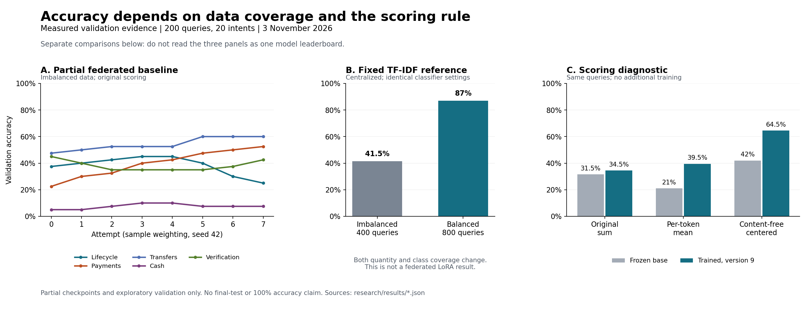

# Accuracy diagnosis and next experiments

**3 November 2026.** We measured a substantial scoring effect: on the same
version-9 model and 200 validation queries, subtracting each label's score on
`N/A` raises accuracy from **34.5% to 64.5%**, without further training. The
deliberately tiny minority training sets and unequal server influence are also
serious constraints. The code audit found no demonstrated masking, label-mapping
or gradient-flow defect. Limited adaptation capacity remains a hypothesis.

This report concerns the twenty-intent prototype. It does not promise 100%
accuracy on unseen queries. A perfect training score or a rehearsed demo is a
different measurement from generalization on held-out BANKING77 queries.

## What we measured

| Measurement | Result | Interpretation |
| --- | --- | --- |
| Active sample-weighted federated run, validation attempt 0 to 7 | Accuracy 31.5% to 37.5%; macro F1 0.2447 to 0.3431; task loss 5.1089 to 2.3252 | The model is learning, but lower token loss does not ensure the right label wins |
| Same run, cash-withdrawal domain at attempt 7 | 7.5% accuracy, versus 60% for transfers | Overall accuracy hides a serious domain gap |
| Accepted clients through attempt 7 | All five in all seven rounds; 224 optimizer steps | These scores are not explained by missing clients or skipped work |
| Version-9 checkpoint, fixed scoring diagnostic | Original sum 34.5%; mean 39.5%; content-free-centered sum 64.5% | Same B and validation data; scoring materially changes the decision boundary |
| Fixed centralized TF-IDF classifier, imbalanced training | 41.5% validation accuracy; 20% worst-domain accuracy | A non-generative classifier also struggles with this data regime |
| Same TF-IDF settings, balanced training | 87% validation accuracy; 77.5% worst-domain accuracy | Better coverage is a promising direction before increasing model size |

The federated values are a fixed **partial** snapshot of
`pilot-r2-20261103-sample`, seed 42, version 7, using imbalanced training.
They are not final results. The unchanged twenty-attempt study remains in
progress. The proposed equal-weight/clipped method had not run at this snapshot.

The two TF-IDF runs use the same 200 validation queries and fixed classifier
settings. Training changes from 400 to 800 examples, with both different total
quantity and different class coverage. This is evidence about the combined data
regime, not an isolated balancing effect or a federated-LoRA result. Run and
configuration identities are in the [imbalanced](results/tfidf-validation.json)
and [balanced](results/tfidf-balanced-validation.json) exports.

### Same-model scoring comparison

The diagnostic fixes three rules before evaluation, preserving EOS in every
case. The centered score is
`log P(label + EOS | query) - log P(label + EOS | N/A)` under the same checkpoint
and chat template. This is a log-score correction, not a calibrated probability.

| Model/checkpoint | Original sum | Mean per token | Content-free-centered sum |
| --- | ---: | ---: | ---: |
| Frozen base / initial B | 31.5% | 21.0% | 42.0% |
| Sample-weighted model / version 9 | 34.5% | 39.5% | 64.5% |

At version 9, centering corrects 65 originally wrong answers and harms five
originally correct answers: a net gain of 60/200, or 30 percentage points.
Macro F1 rises from 0.3150 to 0.6198 and worst-domain accuracy from 7.5% to 45%.
With the same centered rule, version 9 exceeds the frozen base by 22.5 points.
Mean scoring worsens the frozen base; it is not a universal correction.

These are exploratory, single-seed validation results on a partial checkpoint.
They do not establish the performance of the main clipped method or final test.
The current benchmark still uses its original sum rule. Both
[base evidence](results/accuracy-scoring-base.json) and
[version-9 evidence](results/accuracy-scoring-sample-v9.json) retain configuration,
source, manifest and B hashes, all rule results and paired error changes. The
version-9 B hash is
`72944fe97ff45eaf3c0a3c3be3a2ba60f3bbc61b4abe67e25e9e02a30d5da315`.



## Why the current accuracy is low

1. **Most intents have only two or three distinct training queries.** The
   imbalanced scenario gives payments 360 queries and every other domain ten.
   Repeating those ten queries does not supply missing wording and paraphrases.
   By attempt 7, the transfers client had already processed 22.4 times its
   manifest size. More repeats alone may worsen overfitting.
2. **The active baseline gives payments a 90% coefficient.** Each other domain
   gets 2.5%, even though each contributes 20% of validation queries. Payments
   also receives the largest step budget. Equal coefficients address one part
   of this mismatch; their quality effect must be measured.
3. **Learning label strings is not the same as separating twenty classes.**
   The loss scores the true completion; accuracy asks whether it beats every
   alternative. At version 7, `pending_card_payment` was predicted 62 times and
   `pending_transfer` 52 times among 200 queries, although each label has only
   ten validation examples. This is a measured concentration of predictions,
   not proof of one particular cause.
4. **Labels have different token lengths and prior probabilities.** The current
   scorer sums log probabilities, including EOS. Completion lengths span 4–11
   tokens. Length and language priors may affect rankings; longer labels do not
   necessarily lose. The comparison above demonstrates that scoring correction
   can help this checkpoint substantially. It still needs confirmation on
   completed baseline/main checkpoints before adoption.
5. **Client objectives conflict and adaptation is constrained.** Each client
   trains on only four labels; a 135M general model with frozen-A rank-8 q/v
   adapters may need a stronger task representation or more suitable updates.
   These are plausible limitations, not established diagnoses. Shared A solves
   factor aggregation, not every non-IID learning problem.

The audit checked the actual tokenizer: all twenty label boundaries match the
concatenated tokenization; real EOS supervision is retained; training/validation
normalized-query overlap is zero. Only 1/200 validation queries is truncated,
versus 0/400 imbalanced training queries. Existing CPU/GPU smoke evidence shows
that B changes while base/A remain frozen. See the
[code audit](accuracy-code-audit.md), [run audit](accuracy-run-audit.md), and
[primary-source review](accuracy-literature.md) for evidence and limitations.

## What we do next

1. **Complete the current frozen comparison.** Keep the original settings and
   publish sample/equal/clipped results, including unfavorable outcomes. Do not
   change the live scorer or select an earlier peak as the final checkpoint.
2. **Confirm the measured scoring effect on completed checkpoints.** The new
   [diagnostic tool](../tools/diagnose_scores.py) already measured base and
   version-9 results above. Repeat the same three rules on the completed
   sample/main models, without new prompt or offset searching. It records
   corrected and newly harmed predictions, candidate scores, token lengths,
   source hashes and a snapshot of B. Its CLI cannot select the final-test split.
3. **Prioritize the already planned balanced-data model experiment.** The
   forty-example-per-intent case tests practical learning before treating the
   extreme two-to-three-example stress test as the model's general capability.
   Keep it separate from the imbalance benchmark and compare like with like.
4. **Check training fit before enlarging the model.** A small, balanced,
   training-only sanity set can distinguish an optimization problem from a
   generalization problem. If fit remains poor, test a small declared learning
   rate or capacity ablation under a new identity. If training fit is good but
   validation is poor, prioritize coverage and representation.
5. **Use the task-efficiency reference honestly.** The measured 87% TF-IDF
   result and a possible future small sentence-encoder reference help assess
   whether a generative model earns its resource cost. They do not replace the
   promised shared-A federated experiment or establish its accuracy.

The scoring diagnostic passed five transform tests and two full cached-model
CUDA invocations on 200 validation queries each. These took 45.0 seconds for
base and 48.7 seconds for version 9, including loading and scoring, on the idle
prepared GPU. All 200 frozen-base original-rule predictions also match the
previously saved baseline evaluation. The full WSL test suite passes 106 tests
with zero skips. Repeat after the current GPU job so it does not compete with
the single-worker timing benchmark. For example, in the
prepared WSL environment, after that worker is idle:

```sh
python tools/diagnose_scores.py \
  --checkpoint runs/pilot-r2-20261103/runs/main/checkpoint.json \
  --output-dir runs/score-diagnostic-main-001 \
  --device cuda --cpu-threads 4 --eval-batch-size 20
```

Use a new output directory for each invocation. The tool freezes the candidate
rules before scoring, never trains, and leaves the deployed rule unchanged.
It stores no raw query text. A better validation rule is exploratory evidence;
any adopted change needs a new declared comparison and disclosure of previous
test access. More prompt trials against the same 200 examples increase the
risk of overfitting validation.

The study process had stopped between sessions after committing version 9;
its status file still said running. The diagnostic ran while the GPU worker
was absent. The unchanged study was then resumed from its durable checkpoint.
The interruption and original checkpoint-selection rule remain part of the
experiment record.

The figure can be regenerated solely from the committed JSON evidence with
`python tools/plot_accuracy_diagnosis.py` in the reporting environment. Its
[provenance record](results/accuracy-figure-provenance.json) records source and
generator hashes. This command does not load a model or access live run data.

## What an honest 100% claim requires

For this final test, 100% means **500 correct out of 500 untouched official-test
queries**, under a rule fixed before viewing those outcomes. Even that would
not guarantee every future banking query. We should pursue the highest
reproducible accuracy and report macro F1, worst-domain accuracy and resource
cost alongside it. The current evidence supports specific experiments to
improve quality; it does not yet support a percentage promise.
