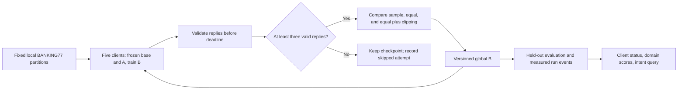

# From problem statement to a testable project

Research synthesis, **2 November 2026**. Audience: the solo implementer and a reviewer asking why this particular prototype should exist. This is a focused decision pass using the existing [landscape](landscape.md), primary sources, the uploaded abstract, and the actual build constraints. It is not a claim to have surveyed all AI/ML research or validated commercial demand.

## Recommendation

Build a reproducible federated adapter-training system, using banking intent routing as the benchmark. The central question is:

> Can a participant with a small compute budget and otherwise missing domain examples improve shared-model utility, while aggregation influence stays visible and an interrupted client cannot block progress indefinitely?

Keep SmolLM2-135M-Instruct, twenty BANKING77 intents, common frozen A, B-only updates, and equal survivor averaging with median norm clipping. Keep sample-weighted and plain-equal baselines. The abstract also promises a centralized fine-tuning comparison: preserve a matched B-only reference. The main innovation opportunity is an informative experiment and reliable implementation under constrained resources. Federated LoRA, frozen A, averaging, and clipping are existing ideas.

The interface predicts one of twenty intents and displays an authored response. It demonstrates intent routing, not learned banking conversation, financial expertise, or production readiness. Five simulated clients demonstrate the stated minimum; they do not establish performance at thousands of devices.

## The ideation process, applied

The Design Council's [Double Diamond](https://www.designcouncil.org.uk/resources/framework-for-innovation/) separates discovering the problem, defining it, developing options, and delivering/test-refining a solution. Apply it iteratively: new evidence can send us back to an earlier decision. For this project, every stage should produce an artifact and a decision, rather than another list of technologies.

| Stage | Question and activity | Artifact | Decision gate |
| --- | --- | --- | --- |
| Discover | Read the problem, abstract, existing methods, hardware constraints, and failure modes; identify who operates clients and who evaluates the model | Evidence register and assumptions | Is the difficulty learning under heterogeneous participation, and what is actually known? |
| Define | Choose one task, resource envelope, baseline, and falsifiable usefulness/reliability claims | Task contract and claim-to-test table | Can the proposed experiment disprove the story? |
| Develop | Compare a small number of alternatives; test data/scoring, local learning, and serial resource cost before networking | Decision log and tiny real diagnostic runs | Does the smallest pipeline learn correctly within available memory/time? |
| Deliver | Connect verified components, run matched comparisons, interrupt a process, and rehearse the evidence | Run records, working demo, limitations | Which claims have passed, failed, or remain untested? |

No customer interviews have been conducted. Banking support is a useful public benchmark, not evidence that banks want this architecture. If access permits, a short conversation with a support-operations or IT practitioner should ask about actual device availability, update windows, data isolation, acceptable errors, and alternatives. The questions are a research plan; do not invent answers. The hackathon's technical benchmark can proceed using explicitly stated assumptions.

## Translate each demand into evidence

| Challenge | Design response | Evidence required | What it would not prove |
| --- | --- | --- | --- |
| Weak clients should contribute | Small model, B-only work, genuine per-client step limits | CPU memory/time and a matched with/without-client utility comparison | Nonzero updates alone do not show useful contribution |
| Scattered data should stay local | Each client reads only its assigned partition and transmits adapter state/metadata | Transport/schema audit; no query text in update messages | Formal privacy, secure aggregation, or protection from update leakage |
| Unequal data should not quietly control coefficients | Visible `1/m` survivor coefficients and clipping telemetry | Logged coefficients, norms, cumulative participation, domain quality | Equal accuracy or equal causal influence |
| Devices can disappear | TTL, collection deadline, validated quorum, committed versions and fresh rejoin | Real process interruption, bounded commit/skip, stale-reply rejection | Learning quality is unaffected by missing clients |
| Shared learning must improve | Completion supervision and fixed twenty-way scoring | Held-out loss and quality versus frozen base and matched references | A convergence theorem or general banking capability |

Google's [federated system-design paper](https://arxiv.org/abs/1902.01046) and the [federated-learning survey](https://arxiv.org/abs/1912.04977) support treating participation, orchestration, and evaluation as substantive systems concerns. Their abstracts/metadata were reviewed; this project has not reproduced their production systems or inherited their scale.

## Options considered and the decisions they support

| Option | Benefit | Cost or limitation | Decision for this checkpoint |
| --- | --- | --- | --- |
| TF-IDF plus logistic regression/linear SVM | Cheap, interpretable intent-classification reference | Does not test shared language-model adapter training | Add a small contextual reference if time permits; fit on training rows only |
| Frozen MiniLM embeddings plus a classifier | Efficient sentence representation suited to short queries | Another model/dependency path; adaptation experiment differs | Optional later context |
| GPT-2 with WikiText-2 | Matches the uploaded abstract and standard language modeling | Less direct domain-level interpretation for this demo | Historical proposal; explain the selected benchmark change |
| SmolLM2-135M with twenty intents | Small instruction model and explicit domain scores | CPU training and label scoring are unmeasured | Retain; pass local gates first |
| TinyLlama, larger Qwen, or a broad assistant | Potentially broader language capability | Larger memory/runtime and less controlled task scope | Defer; do not upgrade before diagnosing small-model failures |
| Train both LoRA factors | Common local PEFT method | Averaging factors does not generally average effective adapters | Use shared frozen A for all matched methods |
| Equal weights plus median clipping | Simple, auditable coefficient and magnitude policy | May sacrifice useful large updates; sensitive to survivor set | Main engineering choice, with separate equal-only ablation |
| Capped sample weights | Intermediate policy between sample and equal weighting | Final normalization/cap feasibility needs an exact rule | Revised stretch idea; see abstract alignment |
| FedProx, SCAFFOLD, FedNova, adaptive ranks, asynchronous rounds | Address specific drift, work, rank, or availability issues | More state, assumptions, comparisons, and debugging | Document extensions; add only in response to a diagnosed need |

The [original BANKING77 work](https://arxiv.org/abs/2003.04807) studies efficient sentence-encoder classification. A generative model is not automatically the cheapest way to solve this task. Its role here is to test federated adaptation machinery. The [PolyAI model repository](https://github.com/PolyAI-LDN/polyai-models) currently states that ConveRT models were withdrawn, so do not schedule this week around reproducing those assets. The [MiniLM card](https://huggingface.co/sentence-transformers/all-MiniLM-L6-v2) describes a possible optional encoder reference; no project result has been measured for it.

## What the chosen mathematics does and does not buy

For common frozen A and scale `s`, the effective adapter is `s * B * A`. Therefore aggregating B linearly also aggregates the corresponding effective adapters linearly. This removes an ambiguity present when independently trained A and B are averaged separately. [FFA-LoRA](https://arxiv.org/abs/2403.12313) already establishes this design direction.

Equal server coefficients change the aggregation policy and relative weighting of returned deltas: each accepted participant receives the same multiplier regardless of its declared sample count. Unequal local steps, AdamW, drift and clipping mean this does not imply optimization of a particular equally weighted empirical risk. The policy need not achieve pooled-example accuracy as high as sample weighting. A difference in overall accuracy and worst-domain accuracy may therefore be a tradeoff, not an implementation error.

Median clipping bounds each accepted B-update norm by that attempt's median. It does not make all update magnitudes equal, guarantee safe directions, or guarantee a useful effective-weight norm. A median of zero suppresses every delta under the chosen rule; conflicting updates can cancel. The server must expose those outcomes. Repeated absence also changes cumulative representation even if every individual attempt uses equal coefficients.

The coefficient policy, magnitude policy, and availability policy need separate evaluation. FedProx can reduce local drift but does not change a server's sample-weighting rule. Clipping is not a demonstrated defense against malicious clients.

## Research questions that decide what to build next

| Hypothesis | Smallest useful test | Decision if it fails |
| --- | --- | --- |
| The local pipeline learns the target | Tiny overfit diagnostic, frozen-base scoring, and short centralized B-only run | Fix masks, completion boundaries, scoring, gradients, and data before federation |
| Unequal weighting matters in this split | Same unequal-data/work condition: sample-weighted vs plain equal | Report the effect/tradeoff; do not credit clipping for a weighting effect |
| Clipping improves useful behavior | Plain equal vs equal plus clipping | Keep the result visible, including any damaged minority domain |
| Client 4 adds useful information | Matched main run with and without that participant | Narrow the useful-inclusion claim if effect is negligible or unfavorable |
| Collection stays bounded | Kill a training process; test both enough and too few survivors | Repair protocol/job cleanup before presenting dropout resilience |
| The complete evidence fits the week | Measure training, initialization, validation, queue and transport cost | Freeze a smaller pilot before examining final-test outcomes |

Exact-string label scoring deserves an early check. Summed completion log probabilities can favor label length/prior effects, while EOS and PAD share a token in the selected tokenizer. [Calibration](https://arxiv.org/abs/2102.09690) and [surface-form competition](https://arxiv.org/abs/2104.08315) are relevant research precedents, not evidence that a particular alternative will solve this fine-tuned task. Test token shifting, padding/batch invariance, genuine EOS supervision, and truncation. The primary scorer remains the [system contract](system-design.md); any validation-supported change must be documented, frozen, and applied to all comparators before final-test evaluation.

## Avoid conclusions the experiment cannot support

The current balanced manifest has 800 training queries; the imbalanced one has 400. Equal work totals 40 optimizer steps per attempt; heterogeneous work totals 32. The rich client also has the largest work budget and the card-payments domain. Comparing strategies **within** one fixed condition remains useful. Comparing those conditions cannot isolate data imbalance, total data, work, and domain identity as separate causes.

Likewise, removing client 4 changes available data, contributor count, coefficients, and the clipping median. The omission experiment measures the total effect of adding that participant to this protocol. It does not prove that slow hardware itself improves learning. A future data-redistribution or matched-total-work control can answer a different causal question.

Use seed-42 results to establish a preliminary observation, not a broad superiority claim. Report the full vector of domain scores and actual work, including misses and skipped attempts. A classifier outperforming the LM is relevant context; it narrows the task-efficiency claim without invalidating the federated-systems experiment.

## Make the demo explain the evidence

Each strategy is a separate matched run; the diagram does not mean combining all three in one update. Public held-out evaluation can run centrally, while each federated client reads only its assigned training partition. Shared storage in simulation models the data boundary; it is not a security isolation claim.

A useful judge-facing story is: show the imposed resource/data imbalance, show the measured tradeoffs, interrupt a process, show whether a version committed, and then run an actual intent query. Present broad literature knowledge through justified decisions, not a dashboard containing many unused algorithm names.

The next executable work is the [seven-day prototype plan](seven-day-prototype.md). [Abstract alignment](abstract-alignment.md) records changed commitments; [sources.md](sources.md) records what was actually reviewed. No learning, convergence, traffic, or memory result was produced by this research pass.
