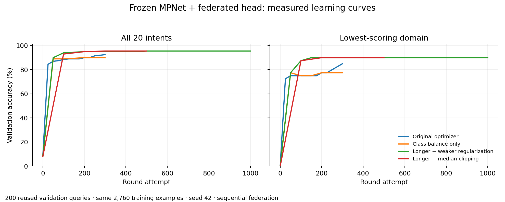

# Class-balanced encoder head

The actual five-client Flower head reached **95.5% (191/200) validation accuracy**
with class-balanced cross-entropy, a longer optimization horizon and weaker
weight decay. Live CPU encoder inference exactly reproduced all cached logits
on the same 200 validation queries. This is still development-set evidence.
The matched 500-attempt equal-plus-median-clipping run also completed at 95.5%.
Unequal full-batch local-step budgets `[1,4,2,2,1]` completed at **95.5%** after
500 attempts with equal averaging, using the same seed, initialization and data.
All 500 Flower attempts committed with all five clients. The selected head hash
is `d85f8e14a62ebaa092c7a1e173e74e5c35a3c6dd59258c08252626f7d6cd7312`.
The complete run took 2,182.17 seconds of server time, excluding startup and
feature preparation, while other experiments shared the laptop. It is not an
isolated speed benchmark. The sequential results below remain separate runs.

## Frozen comparison

All three configurations were written before evaluation. They use the same
MPNet/data manifest, seed 42, equal client weights, one full local batch per
client and SGD. Local objective weights are `N/(K*n_class)`, where `K` is the
number of classes present locally. With four disjoint classes on each of five
clients, the average full-batch gradient equals the twenty-class balanced
objective. A unit test verifies that relationship with unequal class counts.

| Configuration | LR | Weight decay | Attempts | Selected validation accuracy |
| --- | --- | --- | --- | --- |
| Class balance alone | 5 | 0.0004 | 300 | 90.0% |
| Weaker regularization, longer run | 5 | 1/(10*2760) | 1500 | See complete export |
| Faster, longer run | 20 | 1/(10*2760) | 1000 | **95.5%, attempt 500** |

The original unweighted LR5/300-attempt run scored 92.5%; class balancing alone
was worse. This is a combined optimization improvement, not evidence that class
weights universally help. Selection uses accuracy, then macro F1, then the
earliest evaluated checkpoint. Later attempts still run and remain reported.

The earlier sequential selected head hash is
`385ca9ade96264eafb0a77947847f84436b4d9c21d438d01cce378c6467b8cc2`.
Its predictions match centralized logistic C10 exactly. Worst-domain accuracy is
90%. See the [remaining-error analysis](../../encoder-error-analysis.md).

The [offline demo](../../../docs/encoder-demo.md) supports this run, actual Flower
head runs, live questions and recorded training evidence. The full WSL test
suite passed **155 tests, zero skips**. Model selection and all three optional
margin thresholds are now [locked before confirmation](confirmation-plan.json).

- [All three frozen head trials](head-trials.json)
- [Live versus cached inference](live-parity.json)
- [Error overlap](error-overlap.json)
- [Completed equal-plus-clipping run](clipped-head.json)
- [Fresh offline inference](offline-inference.json)
- [Unequal-budget head run](heterogeneous-head.json)
- [Further federated adapter trial](federated-adapter.json)
- [Complete 500-attempt Flower run](flower-head.json)
- [Trained-model dropout and recovery](trained-recovery.json)
- [Unequal budgets with clipping](heterogeneous-clipped-head.json)
- [Weak-client omission](omission-head.json)
- [400-example imbalance comparisons](imbalance-trials.json)
- [Derived imbalance manifest](imbalance-manifest.json)
- [Further centralized adapter reference](centralized-adapter.json)

The offline check used a fresh Linux network namespace with only loopback. An
external connection failed with `Network is unreachable`; pinned model loading
and a card-activation question then completed in 44.54 seconds, including cold
startup. This is not a controlled speed comparison with the warm Windows query
or evidence of training across physical laptops.

Runnable [reproduction configurations](../../../configurations/encoder/README.md)
cover sequential and actual Flower head training. The confirmation utility
locks the final selected checkpoint and source identities before reading the
300-query confirmation file.

The lock also pins actual tokenizer, model configuration and weight bytes,
checked against the training manifest before any confirmation query is opened.
The derived 400-example imbalance study is prepared by
`tools/prepare_encoder_imbalance.py`; it selects only original training IDs from
the verified cache and never opens or copies the confirmation set.

The 100-attempt frozen-A MPNet B-plus-head trial starting from the stronger head
selected attempt **zero** at 95.5%; its final validation score was 95.0%. More
adapter optimization did not improve this measured classifier. The saved run
retains every scheduled evaluation and frozen-base/A checks.

## Selective answering is a different metric

A [validation-only margin diagnostic](selective-diagnostic.json) found 166/167
correct answers (99.40%) at 83.5% coverage, or 157/157 correct answers at 78.5%
coverage. The remaining queries were declined, not counted correct. Full-set
accuracy remains **95.5%**. These thresholds were selected on reused validation
and have not yet been validated on fresh queries. They do not meet an
unqualified 99–100% all-query accuracy claim.

## Completed stress comparisons

| Scenario | Best validation | Final validation | Worst domain at selected checkpoint |
| --- | --- | --- | --- |
| Expanded data, equal budgets, actual Flower | 95.5% | 95.5% | 90% |
| Expanded data, unequal budgets, equal averaging | 95.5% | 95.5% | 90% |
| Expanded data, unequal budgets, median clipping | 95.5% | 95.5% | 90% |
| Expanded data, omit weak client 4 | 77.5% | 77.5% | 0% |
| Original 400 examples, sample weighting | 72.0% | 72.0% | 55% |
| Original 400 examples, equal weighting | 78.5% | 78.0% | 57.5% |
| Original 400 examples, equal weighting plus clipping | 79.0% | 78.5% | 57.5% |

The expanded-data omission pair uses 500 attempts, identical initialization,
hyperparameters and per-client random streams. Client 4 has one optimizer step
per attempt; removing it reduces overall accuracy by 18 percentage points and
its verification domain from 90% to 0%. This is one paired seed, not a
multi-seed significance claim. Its four labels have no other training owner.

The 400-example study reuses the original `[10,360,10,10,10]` training rows and
200-query validation set. It uses equal one-step budgets and 300 attempts.
Sample and clipped configurations were frozen together; the equal-only control
was added afterward with the same remaining settings to separate weighting from
clipping. The half-point gap between equal and clipped is one query and does
not establish reliable superiority. Sample weighting assigns client 1 coefficient
0.9; equal strategies assign each survivor 0.2. Coefficients are not guarantees
of equal domain accuracy.

The trained-model recovery run starts from the 500-attempt Flower checkpoint
and uses clipping. It does not claim to train from scratch in three attempts.
Client 1's optimizer process was killed after one observed step in attempt 2;
the four survivors committed with coefficient 0.25. All five rejoined after
fresh synchronization in attempt 3, restoring coefficient 0.2. Collection times
were 10.27/6.83/1.78 seconds under a 60-second deadline. Accuracy remained 95.5%
at initialization and after every attempt. This is a real process test on one
laptop, not a physical five-device deployment.

`tools/calibrate_encoder_policy.py` records all three fixed empirical targets
(98/99/100%) for a selected checkpoint. The optional `--policy` input to the
confirmation freeze command locks those thresholds before test access, then
reports both answered-query accuracy and coverage for every policy. No policy
may be chosen afterward by hiding an unfavorable confirmation outcome.
