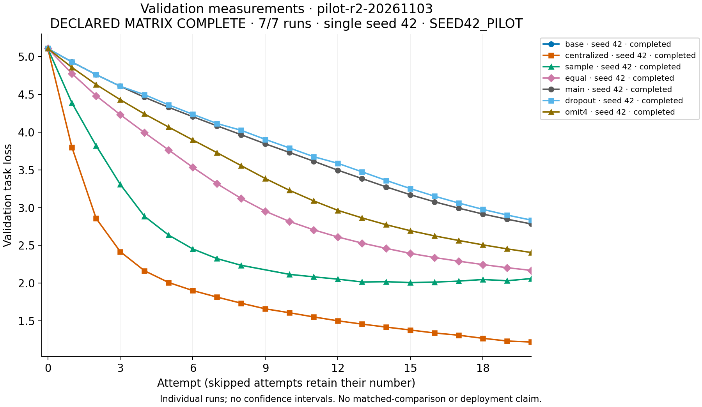
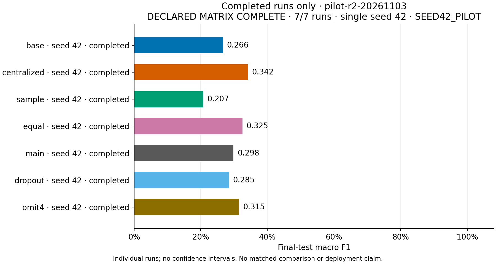

# pilot-r2-20261103

**DECLARED MATRIX COMPLETE · 7/7 runs · single seed 42 · SEED42_PILOT**

Completed seven-configuration seed-42 imbalanced pilot. The full balanced/imbalanced multi-seed program is not complete. Sample weighting resumed after an interrupted invocation whose time was not fully recorded; its phase total is incomplete and must not be used for end-to-end runtime comparisons.

Frozen plan SHA-256: `82a05841701de0e477555e67031c65734a8d791c0434eb1f9b4bc13062137b7a`. Full run/config/source/A/B/manifest identities: `publication.json`.

Missing values are not zero. Final-test scores require a completed status and matching checkpoint/configuration/horizon evidence.
Validation figures also retain incomplete runs, labelled by status. No seed means or confidence intervals are estimated.

Phase wall seconds sum recorded child phases, including retry history; orchestration gaps are excluded. Work is accepted-reply/reported-centralized telemetry, including partial centralized blocks. Coverage is in publication.json.
Traffic is serialized application request/reply bytes, not measured network-wire traffic; initial asset/A transfer is excluded. No matched-comparison, superiority, or physical-laptop claim is established.

Current source files differing from the frozen plan: none. Historical hashes are retained; this does not validate a rerun.

## Measured summary

| key | status | seed | attempts_recorded | attempts | accuracy | macro_f1 | worst_domain_accuracy | domain_gap |
| --- | --- | --- | --- | --- | --- | --- | --- | --- |
| base | completed | 42 | 0 | 0 | 0.32 | 0.266329 | 0.11 | 0.4 |
| centralized | completed | 42 | 20 | 20 | 0.406 | 0.341557 | 0.23 | 0.48 |
| sample | completed | 42 | 20 | 20 | 0.246 | 0.207424 | 0.02 | 0.69 |
| equal | completed | 42 | 20 | 20 | 0.354 | 0.325263 | 0.14 | 0.4 |
| main | completed | 42 | 20 | 20 | 0.344 | 0.298319 | 0.14 | 0.38 |
| dropout | completed | 42 | 20 | 20 | 0.334 | 0.284592 | 0.14 | 0.37 |
| omit4 | completed | 42 | 20 | 20 | 0.348 | 0.315127 | 0.15 | 0.4 |

## Work, time and traffic

| key | status | optimizer_steps | processed_examples | processed_tokens | reported_training_seconds | serialized_request_bytes | serialized_reply_bytes | phase_wall_seconds |
| --- | --- | --- | --- | --- | --- | --- | --- | --- |
| base | completed | Not recorded | Not recorded | Not recorded | Not recorded | Not recorded | Not recorded | 200.241 |
| centralized | completed | 640 | 2560 | 143089 | 494.673 | Not recorded | Not recorded | 1248.95 |
| sample | completed | 640 | 2560 | 143089 | 688.58 | 7.5235e+07 | 7.54165e+07 | 1100.3 |
| equal | completed | 640 | 2560 | 143089 | 562.969 | 7.52348e+07 | 7.54165e+07 | 1514.79 |
| main | completed | 640 | 2560 | 143089 | 430.585 | 7.52347e+07 | 7.5416e+07 | 1814.65 |
| dropout | completed | 592 | 2368 | 132853 | 559.905 | 7.52351e+07 | 7.31579e+07 | 1561.02 |
| omit4 | completed | 600 | 2400 | 135858 | 459.911 | 6.01879e+07 | 6.0335e+07 | 1312.8 |

## Final-test per-domain accuracy

| key | status | Account verification | Card lifecycle | Card payments | Cash withdrawals | Transfers |
| --- | --- | --- | --- | --- | --- | --- |
| base | completed | 0.46 | 0.36 | 0.16 | 0.11 | 0.51 |
| centralized | completed | 0.24 | 0.23 | 0.62 | 0.23 | 0.71 |
| sample | completed | 0.1 | 0.03 | 0.71 | 0.02 | 0.37 |
| equal | completed | 0.36 | 0.3 | 0.43 | 0.14 | 0.54 |
| main | completed | 0.32 | 0.44 | 0.3 | 0.14 | 0.52 |
| dropout | completed | 0.31 | 0.44 | 0.27 | 0.14 | 0.51 |
| omit4 | completed | 0.32 | 0.37 | 0.35 | 0.15 | 0.55 |

