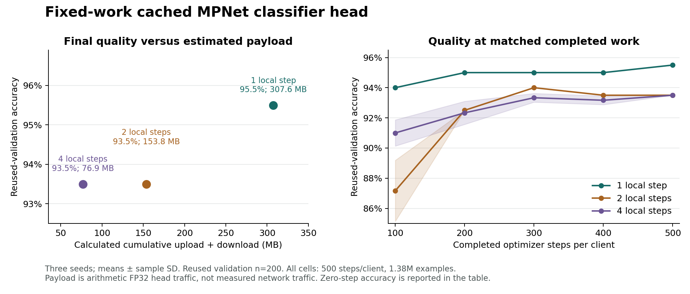

# Fixed-work head accuracy/resource study — resource-frontier-v1

All nine predeclared cells completed on 4 November 2026. At exactly 500 optimizer steps per client, one local step per round scored **95.5% (191/200)** and two or four local steps scored **93.5% (187/200)** on every seed. Four steps reduced calculated head payload by **75%** and observed mean process wall time by **66.8%** relative to one step. The observed cost is two percentage points of reused-validation accuracy.

This is development evidence from cached frozen MPNet features and a trained linear classifier head: five sequential numerical clients on one host, **not LoRA, Flower, physical-device performance, or new test accuracy**. The 200-query validation set was already reused for development. The confirmed demo and all original, confirmation, CLINC and scope locks remain separate; this study does not score those sets or replace the deployed model.

[Pre-run plan](plan.md) · [Frozen machine plan](plan.json) · [All results and statistics](summary.json) · [Figure source](plot.py) · [SVG](resource-frontier.svg)

## Final results

Mean ± sample SD across seeds 42/43/44. MB is decimal; MiB is binary. Payload is calculated, not measured network traffic.

| Steps/client/round | Rounds | Accuracy (%) | Macro F1 | Worst domain (%) | Cross-entropy | Estimated payload (MB) | Process wall (s) | Peak process RSS (MiB) |
| --- | --- | --- | --- | --- | --- | --- | --- | --- |
| 1 | 500 | 95.5 ± 0.0 | 0.95504 ± 0.00000 | 90.0 ± 0.0 | 0.20746 ± 0.00010 | 307.6 | 85.50 ± 11.01 | 654.70 ± 3.47 |
| 2 | 250 | 93.5 ± 0.0 | 0.93339 ± 0.00000 | 87.5 ± 0.0 | 0.22509 ± 0.00012 | 153.8 | 48.48 ± 3.98 | 656.37 ± 0.31 |
| 4 | 125 | 93.5 ± 0.0 | 0.93375 ± 0.00063 | 87.5 ± 0.0 | 0.24012 ± 0.00169 | 76.9 | 28.37 ± 2.32 | 656.40 ± 0.22 |

All nine final observations (no checkpoint selection):

| Cell | Accuracy (%) | Macro F1 | Cross-entropy | Process wall (s) | Peak RSS (MiB) |
| --- | --- | --- | --- | --- | --- |
| s42-local1 | 95.5 | 0.955040 | 0.207555 | 94.334 | 650.703 |
| s42-local2 | 93.5 | 0.933386 | 0.225161 | 51.717 | 656.727 |
| s42-local4 | 93.5 | 0.933386 | 0.241814 | 29.502 | 656.625 |
| s43-local1 | 95.5 | 0.955040 | 0.207357 | 88.999 | 656.539 |
| s43-local2 | 93.5 | 0.933386 | 0.224947 | 49.687 | 656.207 |
| s43-local4 | 93.5 | 0.934477 | 0.238427 | 29.903 | 656.391 |
| s44-local1 | 95.5 | 0.955040 | 0.207462 | 73.164 | 656.871 |
| s44-local2 | 93.5 | 0.933386 | 0.225156 | 44.031 | 656.180 |
| s44-local4 | 93.5 | 0.933386 | 0.240110 | 25.703 | 656.188 |

## Every scheduled accuracy observation

Columns are completed optimizer steps **per client**; entries are reused-validation accuracy (%). The machine summary retains all 54 complete metric records, per-intent/domain results, state hashes, cumulative timings, actual work and estimated payload at each checkpoint.

| Cell | 0 | 100 | 200 | 300 | 400 | 500 |
| --- | --- | --- | --- | --- | --- | --- |
| s42-local1 | 8.0 | 94.0 | 95.0 | 95.0 | 95.0 | 95.5 |
| s42-local2 | 8.0 | 86.0 | 92.5 | 94.0 | 93.5 | 93.5 |
| s42-local4 | 8.0 | 91.5 | 92.5 | 93.5 | 93.0 | 93.5 |
| s43-local1 | 4.5 | 94.0 | 95.0 | 95.0 | 95.0 | 95.5 |
| s43-local2 | 4.5 | 86.0 | 92.5 | 94.0 | 93.5 | 93.5 |
| s43-local4 | 4.5 | 90.0 | 91.5 | 93.0 | 93.0 | 93.5 |
| s44-local1 | 2.5 | 94.0 | 95.0 | 95.0 | 95.0 | 95.5 |
| s44-local2 | 2.5 | 89.5 | 92.5 | 94.0 | 93.5 | 93.5 |
| s44-local4 | 2.5 | 91.5 | 93.0 | 93.5 | 93.5 | 93.5 |

Final per-domain accuracy is identical across all three seeds for each schedule (sample SD 0.0 percentage points). The one-step advantage is in Transfers; matching overall scores do not imply identical predictions.

| Local steps | Lifecycle (%) | Payments (%) | Transfers (%) | Cash (%) | Verification (%) | Domain gap (pp) |
| --- | --- | --- | --- | --- | --- | --- |
| 1 | 97.5 | 95.0 | 97.5 | 97.5 | 90.0 | 7.5 |
| 2 | 97.5 | 95.0 | 87.5 | 97.5 | 90.0 | 10.0 |
| 4 | 97.5 | 95.0 | 87.5 | 97.5 | 90.0 | 10.0 |

## Timing and memory

All cells performed **2,500 optimizer steps and 1,380,000 processed examples**. Per-client totals were 256,500 / 307,500 / 304,000 / 308,000 / 204,000 examples. The raw affine head is **61,520 bytes** (15,380 FP32 parameters). The fixed full-batch SGD settings, initial tensors and dataset hashes are in the frozen plan.

Mean ± sample SD in seconds:

| Local steps | Cell wall | Summed local trainer calls | Optimizer loop (subset) | Aggregation | Evaluation (six passes) |
| --- | --- | --- | --- | --- | --- |
| 1 | 84.225 ± 10.800 | 38.031 ± 4.847 | 6.727 ± 0.817 | 18.808 ± 1.918 | 0.040 ± 0.024 |
| 2 | 47.293 ± 3.887 | 22.906 ± 2.058 | 6.591 ± 0.630 | 9.407 ± 0.613 | 0.028 ± 0.004 |
| 4 | 27.275 ± 2.245 | 14.365 ± 1.187 | 6.168 ± 0.645 | 4.604 ± 0.333 | 0.024 ± 0.001 |

The supervisor started **fresh serial Linux subprocesses** in predeclared rotated order, with one CPU thread and OMP/MKL/OpenBLAS/NumExpr thread limits of one. Root inference/tests and video encoding were paused throughout the timed interval. Total child-process wall time was 487.039 seconds. The process clock includes startup, imports and exit. Cell wall includes source/data verification, loading, training, aggregation, evaluation and output writing before final result serialization. Trainer-call timing includes its validation, state conversion/hash, optimizer setup and monitoring overhead; optimizer-loop timing is a subset and must not be added again. Unattributed cell overhead includes state replacement, delta conversion, orchestration, hashing and I/O. Equal optimizer steps therefore do not imply equal total arithmetic work.

Peak RSS is the **complete child-process lifetime high-water mark**, obtained after exit using Linux `os.wait4` rusage and converted from KiB to bytes. It includes Python/Torch imports, all five resident feature caches, validation, training and serialization. It excludes the supervisor/other processes, encoder inference/preparation and physical-device clients. The child also saves an explicitly named earlier RSS observation; the published peak comes from the supervisor. One process sample per seed is not a repeated hardware timing experiment. Later cells ran faster, so host/runtime drift may affect time comparisons despite serial scheduling.

Runtime: AMD Ryzen 5 6600H, 12 logical CPUs visible to WSL2; Linux 6.6.87.2, Python 3.11.15, Torch 2.8.0+cu126 **used on CPU**, NumPy 2.4.6, psutil 7.2.2. No GPU timing or memory measurement is claimed.

## Tradeoff and limits

The estimate is `2 × 5 × rounds × 61,520`: one head download and delta upload per client per round. The 307.6 / 153.8 / 76.9 MB totals include first-round head distribution but exclude encoder/data transfer, metadata, transport overhead, retries and final deployment. **No serialized or wire bytes were measured.**

For the predeclared **accuracy-versus-payload** frontier, local-step 1 and 4 are non-dominated: one has higher accuracy; four has lower estimated payload. Four dominates two on those two dimensions because both score 93.5% and four uses half the payload. When process time and RSS are also included, **all three are formally non-dominated**: local-step 4's mean RSS is about 0.030 MiB above local-step 2. That tiny difference is not evidence of a practical memory advantage. Two steps also have lower cross-entropy than four, so four does not dominate every quality metric.

Paired final accuracy differences versus one step are **−2.0 pp for every seed**, for both two and four steps (mean −2.0 pp, sample SD 0.0). Their worst-domain accuracy is 2.5 pp lower and domain gap 2.5 pp wider. Zero observed accuracy SD means these three seeds had equal counts on these 200 queries; it is not zero uncertainty about generalization. This result supports retaining one step for accuracy-focused development and considering four steps when estimated communication cost is the constraint. It does not justify replacing the confirmed demo, changing thresholds, or claiming a new untouched evaluation.

## Identity and reproduction

Plan hash: `26acc3bc1ae1e58d25a03441971e0186abf78c6d2729d648b8c6748e3921e03a`. Baseline: `9a8be35386d9423ee75ae73e8e4b94aa80604781`. The public plan was written locally at `2026-11-04T03:48:18.232221+00:00`, before any measured cell. This is a development plan, not a pre-pushed independent-test lock. The runner verified source/data/runtime/initialization hashes before each cell; no frozen source or initial tensor was changed during execution.

Follow [plan.md](plan.md) for exact commands and separate reproduction directories. `tools/run_resource_frontier.py report` verifies the frozen plan and process/result identities and regenerates `summary.json`. `python research/results/resource-frontier-v1/render_report.py` regenerates this report. `python research/results/resource-frontier-v1/plot.py` renders the PNG/SVG using Matplotlib; plotting reads only the summary. The exported figure was rendered with Matplotlib 3.10.8 in an isolated ignored plotting package directory, after timing; the pinned benchmark environment was not modified.

The eight focused boundary/configuration tests pass in the WSL benchmark environment with zero skips. They cover matched work and full batches, prohibited configuration changes, payload arithmetic, actual-work rejection, source/public-plan/initialization tampering, incomplete/mixed evidence, strict Pareto dominance and sample standard deviation. The repository-wide required suite is recorded separately by the integration run.
