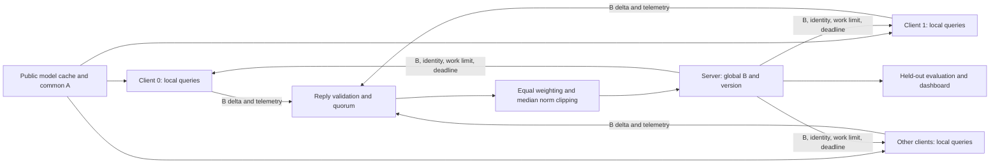

# System design and training contract

This is the implementation reference for the approved system. Except for tensor-state helpers, the components described here still need to be built and tested.

## Architecture

Training queries remain on their assigned client. The server owns a separate held-out evaluation set and authored response templates. In the public-data simulation, partitions are constructed centrally before being assigned to clients; that benchmark setup is not evidence of protection for real private banking data.

Use the same local training function behind Flower ClientApp in simulation and Deployment Runtime. The ServerApp manages requests, validation, aggregation, checkpoints, and evaluation. Avoid separate implementations that silently use different optimization or masking rules.

## Why one common frozen A matters

For each adapted layer, write the effective weight as:

$$
W_i = W_0 + s B_i A, \qquad s=\alpha/r.
$$

Here A has shape `rank × input_features` and B has shape `output_features × rank`. Initialize A once centrally using a recorded seed; initialize B to zero. Distribute the actual saved A tensors once rather than relying only on clients reproducing a random seed.

With common A and scaling, averaging B gives the corresponding average effective adapter update:

$$
\left(\sum_i p_i B_i\right)A = \sum_i p_i B_i A.
$$

If clients independently train both A and B, in general `mean(B) × mean(A)` is not `mean(B × A)`. Factor-coordinate symmetries also complicate comparing independently initialized adapters. Shared frozen A removes that particular factor-aggregation mismatch. It does not prove convergence under arbitrary data, work limits, or dropout.

FFA-LoRA is the relevant existing method; the primary paper's title is *Improving LoRA in Privacy-preserving Federated Learning*. See [sources.md](sources.md).

## Model and adapter identity

| Field | Fixed value or rule |
| --- | --- |
| Model | `HuggingFaceTB/SmolLM2-135M-Instruct` |
| Revision | `12fd25f77366fa6b3b4b768ec3050bf629380bac` |
| Targets | `q_proj`, `v_proj` |
| Rank / alpha / dropout | 8 / 16 / 0.05 |
| Trainable tensors | LoRA B only |
| Frozen tensors | Entire base model and common A |
| Wire/checkpoint dtype | FP32 B tensors |
| Identity | Base model ID/revision, tokenizer identity, adapter settings, scaling, sorted tensor names/shapes/dtypes, common-A hash |

Pin tokenizer files to the same revision. Cache all assets before offline rehearsal. The client must validate identity before applying global B or starting training. Validate the actual A hash; a matching configuration JSON is insufficient if the tensors differ.

For the selected architecture, the estimate is 30 layers with Q output width 576 and V output width 192. At rank 8, B contains `30 × 8 × (576 + 192) = 184,320` parameters. FP32 storage is `184,320 × 4 = 737,280` bytes, or 0.703125 MiB. Confirm the realized tensor count in the model smoke test. This estimate excludes A transfer, envelopes, serialization, retransmission, base-weight memory, and activations.

## Local training

Use AdamW with learning rate `2e-4`, weight decay 0, microbatch size 1, gradient accumulation 4, maximum sequence length 128, and local gradient clipping at 1. CPU runs use FP32. GPU mixed precision requires a separate validated path.

Each accepted request starts from its received global B. Reset optimizer state at every round attempt. A client's work budget is an optimizer-step limit, not a dataset-size claim or artificial sleep. Report completed optimizer steps, microbatches, examples/tokens processed, elapsed time, peak RSS, and available GPU memory measurements.

Construct a prompt from the banking query and an assistant completion containing the exact intent label plus real EOS. Prompt and padding labels are `-100`. Preserve supervision for the intent tokens and real EOS, even when PAD and EOS share a token ID. Use attention masks and explicit completion boundaries; the selected tokenizer's chat template must not be assumed to provide assistant-generation masks. Reject or report sequences whose truncation removes supervised intent/EOS tokens.

At inference, score only the 20 allowed completions using their conditional token log probabilities under the same prompt/template convention. Choose and document one scoring rule before experiments; the default is the sum of completion-token log probabilities, with EOS treatment fixed across all candidates and baselines. Label lengths can affect this score, so do not silently change to length normalization after seeing final-test results.

Optional FedProx adds a B-coordinate penalty `mu/2 × ||B - B_start||²` to local task loss. `B_start` is a detached, fixed copy of the received state. Tune mu on validation only; it does not change the server's aggregation coefficients.

## Aggregation

Let valid replies be `S_t`, with `m = |S_t|`, and global state B_t. For each client, form its delta `u_i = B_i - B_t`. Compute one norm across every B tensor together:

$$
C_t=\operatorname{median}_{i\in S_t}\|u_i\|_2,\quad
v_i=u_i\min\left(1,\frac{C_t}{\|u_i\|_2+\epsilon}\right),\quad
B_{t+1}=B_t+\frac{1}{m}\sum_{i\in S_t}v_i.
$$

Use deterministic median semantics; for an even contributor count, use the mean of the two middle norms. Set and record epsilon. Log original norms, threshold, clip factors, clipped norms, zero deltas, equal coefficients, and aggregate norm. If the median is zero, the formula yields no effective update; log that outcome rather than inserting an unreported positive threshold.

Compare with sample-weighted averaging and unclipped equal averaging using the same common A. For the naive baseline, sample weights come from declared training-manifest sizes; separately log actual completed work. The main policy intentionally separates sample ownership from server coefficients.

Equal weighting means `1/m` for survivors: three valid clients receive one third each; two live survivors receive one half each. It does not impose a permanent 20% cap, guarantee equal domain accuracy, or remove availability bias. Median clipping is a sensitivity control, not a malicious-client robustness guarantee.

## Request and reply contract

Requests carry run ID, attempt ID, current model version, global-B hash, model/adapter contract hash, common-A hash, selected client ID, work limit, and deadline. Replies echo those identifiers and report completion status, completed work, timing/memory telemetry, and the B delta relative to that request.

Reject wrong run/attempt/version, wrong base hash, incompatible contracts, missing or extra tensors, wrong shapes/dtypes, nonfinite values, duplicate client replies, and late replies. Validate finite computed deltas and final aggregate as well as received tensors. Count only replies that satisfy the successful-work rule. Clients with zero completed optimizer steps do not satisfy that rule; a finite zero delta after reported completed work has a distinct, explicitly logged outcome.

Transport authentication binds responses to known nodes. Timing and work telemetry are client reports, not cryptographic proof of training. Closed, trusted nodes are the selected deployment boundary.

## Attempt lifecycle and recovery

1. Take an immutable snapshot of committed B/version and choose currently available participants.
2. Send fresh requests with both Flower message TTL and a bounded response-collection timeout.
3. Validate replies against that snapshot, deduplicate contributors, and close collection at the deadline.
4. Require three valid updates in five-client simulation or two in three-laptop deployment.
5. Below quorum, retain the global checkpoint and log a skipped attempt. Do not count it as a completed training round.
6. At quorum, aggregate from the same snapshot, atomically commit B and version metadata, and evaluate the committed state.
7. A rejoining client synchronizes the latest committed B and identity before starting new work. Never merge an old partial update.

The live deadline starts at 60 seconds and requires budget calibration before rehearsal. Simulation deadlines must include queued GPU execution; with one worker, five clients do not run simultaneously. Flower worker resource reservations are soft scheduling controls, not enforced RAM limits. A timed-out task also needs cleanup/deadline checks so it does not retain scarce compute indefinitely.

Separate attempt counters from committed model versions. Persist configuration/manifest hashes, seed, accepted/rejected/absent clients, clipping details, timings, validation metrics, and checkpoint hashes. Use a temporary file and atomic rename for a checkpoint commit; interrupted writes must not replace a good checkpoint.

## Deployment and privacy

The host runs SuperLink, evaluation, the dashboard, and a client for lifecycle/payments. CPU laptop 1 covers transfers/cash; CPU laptop 2 covers verification. Use the Deployment Runtime, TLS, authenticated known nodes, and a dedicated LAN/hotspot. Reserve host memory for evaluation in addition to training.

Data locality reduces raw-data transfer. TLS protects transport. Node authentication restricts participation. None of these gives differential privacy or makes model updates confidential from the server. Secure aggregation would also constrain individual-norm and influence inspection; adding it requires revisiting server-visible telemetry and clipping design.

See [evaluation.md](evaluation.md) for failure tests and [roadmap.md](roadmap.md) for deployment gates.
